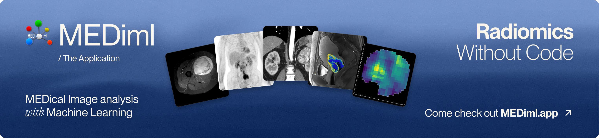
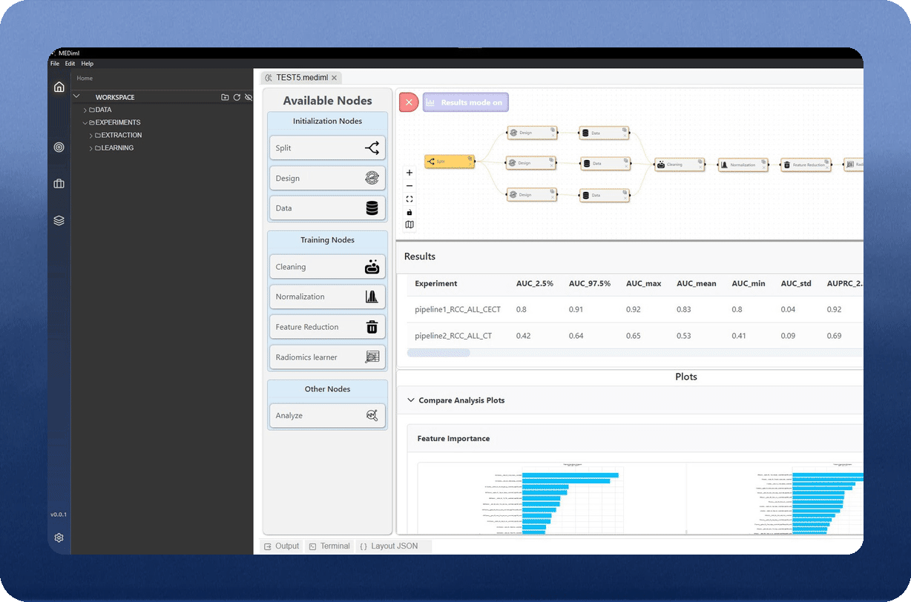
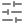

<p align="center">
  <a href="https://mediml.app">
    
  </a>
</p>

<p align="center"><strong>A desktop application for radiomics analysis.</strong></p>

<p align="center">
  <a href="https://github.com/MEDomicsLab/MEDiml-app/releases"></a>
  <a href="https://github.com/MEDomicsLab/MEDiml-app/actions/workflows/automaticBuilding.yml"></a>
  <a href="#supported-operating-systems"></a>
  <a href="LICENSE"></a>
</p>

<!-- Equal insets center the borderless links and demo as a group on desktop. -->
<div>
  <picture>
    <source media="(min-width: 1150px)" srcset=".github/assets/readme/layout-spacer.svg" width="15%" height="204">
    <source media="(min-width: 850px)" srcset=".github/assets/readme/layout-spacer.svg" width="8%" height="204">
    
  </picture>
  <picture>
    <source media="(min-width: 1150px)" srcset=".github/assets/readme/layout-spacer.svg" width="15%" height="204">
    <source media="(min-width: 850px)" srcset=".github/assets/readme/layout-spacer.svg" width="8%" height="204">
    
  </picture>
  <a href=".github/assets/readme/mediml_gui.gif">
    <picture>
      <source media="(min-width: 1150px)" srcset=".github/assets/readme/mediml_gui.gif" width="41%">
      <source media="(min-width: 850px)" srcset=".github/assets/readme/mediml_gui.gif" width="43%">
      
    </picture>
  </a>
  <br><br>
</div>

<p>
  <picture></picture>&nbsp;&nbsp;&nbsp;<a href="https://medomicslab.gitbook.io/mediml-app-docs">Documentation</a>
</p>

<p>
  <picture></picture>&nbsp;&nbsp;&nbsp;<a href="https://mediml.app">Website</a>
</p>

<p>
  <picture></picture>&nbsp;&nbsp;&nbsp;<a href="https://arxiv.org/abs/2610.37715">Paper&nbsp;(Submitted)</a>
</p>

<p>
  <picture></picture>&nbsp;&nbsp;&nbsp;<a href="https://arxiv.org/abs/2610.29666">Reference&nbsp;Manual</a>
</p>

<br clear="all">

## <a id="table-of-contents"></a> Table of Contents
  * [Introduction](#introduction)
  * [Installation](#installation)
  * [Proof of concept](#proof-of-concept)
  * [Documentation](#documentation)
  * [Getting help](#getting-help)
  * [Contributing](#contributing)
  * [Citation](#citation)
  * [License](#license)

## <a id="introduction"></a> Introduction

MEDiml-app puts the [MEDiml Python package](https://github.com/MEDomicsLab/MEDiml-pkg) behind an interactive interface: the whole radiomics pipeline, from raw medical images to predictive models, runs from a single desktop app.

Radiomics turns medical images (CT, MR, PET, radiotherapy dose maps) into quantitative features that can feed predictive models of diagnosis, treatment response or outcome. Computing these features reproducibly is hard: the results depend on many preprocessing choices (voxel size, re-segmentation range, discretisation, filters), and the standardized tools that implement them, such as MEDiml, which follows the [Image Biomarker Standardisation Initiative (IBSI)](https://theibsi.github.io/), are programming libraries.

Many of the people who need radiomics features, such as clinicians, medical physicists and clinical researchers, do not program. MEDiml-app closes that gap. It lets them:

<table>
  <tr>
    <td width="33%" valign="top">
      <br>
      <b>Convert data</b><br>
      Convert DICOM/NIfTI datasets to MEDiml format and validate them.
    </td>
    <td width="33%" valign="top">
      <br>
      <b>Configure settings</b><br>
      Use ready-to-use, editable and validated extraction settings.
    </td>
    <td width="33%" valign="top">
      <br>
      <b>Extract features</b><br>
      Extract radiomics and dosiomics features across a dataset.
    </td>
  </tr>
  <tr>
    <td width="33%" valign="top">
      <br>
      <b>Save results</b><br>
      Save results with their settings for reporting and reproducibility.
    </td>
    <td width="33%" valign="top">
      <br>
      <b>Build models</b><br>
      Apply machine learning models to extracted features.
    </td>
    <td width="33%" valign="top">
      <br>
      <b>Design workflows</b><br>
      Design and run workflows tailored to each study.
    </td>
  </tr>
</table>

> [!TIP]
> It also gives researchers who do program a fast way to prototype MEDiml settings before scripting them.

## <a id="installation"></a> Installation

### <a id="desktop-installer"></a> Desktop installer (recommended)

1. **[Download MEDiml-app](https://www.mediml.app/#download)** for your operating system. Installers are also available on [GitHub Releases](https://github.com/MEDomicsLab/MEDiml-app/releases).
2. Follow the [Quick start guide](https://medomicslab.gitbook.io/mediml-app-docs/quick-start) to install the app and get started.

#### <a id="supported-operating-systems"></a> Supported operating systems

| Operating system | Installer |
| --- | --- |
| Windows 10 or 11 (64-bit) | `.exe` |
| Ubuntu 22.04 or later (64-bit) | `.deb` |
| macOS (Apple silicon) | `.dmg` |

#### <a id="requirements"></a> Requirements

- A 64-bit operating system from the list above.
- An internet connection on first launch: the app downloads its own Python 3.9 environment (with MEDiml) into `~/.mediml/python`, and MongoDB. No Python installation is needed beforehand.

### <a id="run-from-source"></a> Run from source

<details>
<summary>Build and run locally, including development setup and installer builds</summary>


Prerequisites: [Git](https://git-scm.com/), [Node.js 18](https://nodejs.org/) and [Go 1.21 or later](https://go.dev/doc/install) ([Go 1.24 or later on macOS](https://go.dev/doc/install)).

```bash
git clone https://github.com/MEDomicsLab/MEDiml-app.git
cd MEDiml-app

# 1. JavaScript dependencies
npm install

# 2. Go server (rebuild it after any change to go_server/)
cd go_server
go build main.go
cd ..

# 3. Start the app in development mode
npm run dev
```

**Python environment:** on first launch, the setup dialog installs Python 3.9 and the packages listed in [`pythonEnv/requirements.txt`](pythonEnv/requirements.txt) (MEDiml included) into a `python/` folder in the repository, as well as MongoDB. If `~/.mediml/python` already exists, for example from an installed copy of the app, it is used instead.

To build the installers yourself, run `npm run build:win`, `npm run build:linux` or `npm run build:mac` on the matching operating system. The files are written to `build/dist/`.

</details>

## <a id="proof-of-concept"></a> Proof of concept

New to MEDiml-app? Follow the [Soft-Tissue Sarcoma proof of concept](https://medomicslab.gitbook.io/mediml-app-docs/soft-tissue-sarcoma-poc), an easy-to-follow guide to get familiar with the app. It walks through a full radiomics study for the early evaluation of lung metastasis risk, from feature extraction to model training and evaluation.

Its imaging data (PET, T1, T2FS and CT scans for each patient, derived from a public TCIA cohort) is published on [Zenodo](https://zenodo.org/records/23103630). You can download it from the app's home page, straight into your workspace under `DATA/STS_POC`.

## <a id="documentation"></a> Documentation

- [MEDiml-app documentation](https://medomicslab.gitbook.io/mediml-app-docs), with the [Quick start](https://medomicslab.gitbook.io/mediml-app-docs/quick-start) and tutorials
- [MEDiml Python package](https://github.com/MEDomicsLab/MEDiml-pkg) and its [documentation](https://mediml.readthedocs.io)

## <a id="getting-help"></a> Getting help

- **Bugs and feature requests**: open an issue on [GitHub Issues](https://github.com/MEDomicsLab/MEDiml-app/issues).
- **Questions and discussion**: join the [MEDomics Discord](https://discord.gg/ZbaGj8E6mP).

## <a id="contributing"></a> Contributing

Contributions are welcome. See [CONTRIBUTING.md](CONTRIBUTING.md) and our [Code of Conduct](CODE_OF_CONDUCT.md).

## <a id="citation"></a> Citation

If you use MEDiml in your research, please cite it using:

```bibtex
@misc{loutfi2026mediml,
  title         = {{MEDical Image analysis with Machine Learning (MEDiml)}: Strategies for Simpler Radiomics},
  author        = {Ait Lhaj Loutfi, Mahdi and others},
  year          = {2026},
  eprint        = {2610.37715},
  archiveprefix = {arXiv},
  doi           = {10.48550/arXiv.2610.37715}
}
```

The [MEDiml reference manual](https://arxiv.org/abs/2610.29666) explains the radiomics concepts and workflow shared by the Python package and desktop application, including image preprocessing, feature extraction, predictive modelling and interpretation. It also covers the software architecture and installation, compares MEDiml with other tools, and illustrates its use on five oncological imaging cohorts.

## <a id="license"></a> License

MEDiml-app is released under the [GNU General Public License v3.0](LICENSE).
